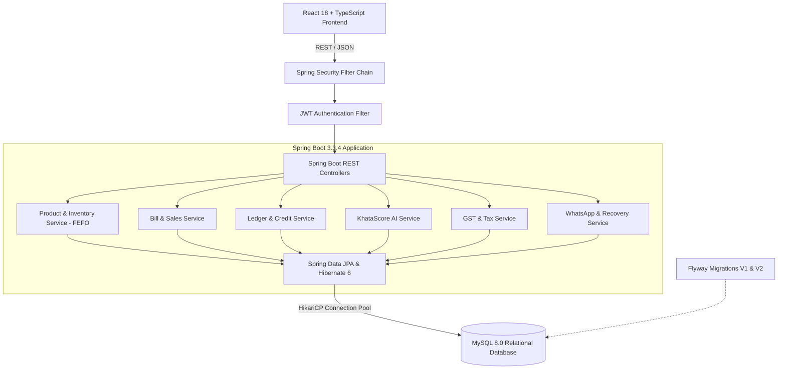
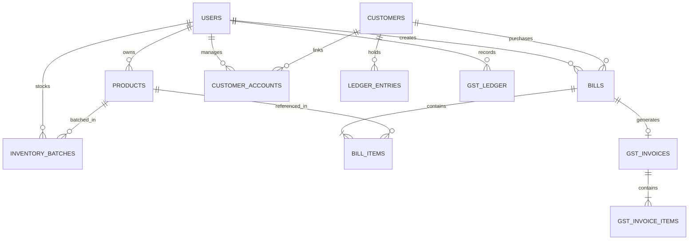

<div align="center">
  <h1>KiranaLink / Smart Dukaan 🏪</h1>
  <h3>Enterprise Java Full Stack (JFS) AI Retail & Credit Management Platform</h3>
  <p>Migrated from Node/Express/MongoDB to <b>Java 21, Spring Boot 3.3.4, Spring Data JPA, MySQL 8.0, Flyway & React 18</b></p>
</div>

---

## 🚀 Overview

**KiranaLink / Smart Dukaan** is an AI-powered retail, billing, inventory, and customer credit management platform built to modernize traditional grocery (*kirana*) stores in India.

The platform solves the critical pain points of small retailers:
- **Khata / Customer Credit Management:** Eliminates manual paper ledgers with automated tracking and the proprietary **KhataScore™ (300–900)** credit scoring engine.
- **First-Expired First-Out (FEFO) Inventory:** Prevents inventory loss by prioritizing goods nearing expiry for discount bundles and automated waste logging.
- **GST & ITR Compliance:** Automatic HSN classification, dual CGST/SGST reverse calculation, input tax credit (ITC) tracking, and GSTR-3B monthly summaries.
- **Omnichannel WhatsApp & Voice Workflows:** Inbound conversational ordering, outbound automated debt recovery, and AI voice calls via OpenAI, Twilio, and Vapi.
- **Razorpay Payments:** QR code generation, server-side order generation, and HMAC-SHA256 signature verification.

---

## 🏗️ Architecture & Technology Stack



### Technology Matrix
| Layer | Technologies |
| :--- | :--- |
| **Backend** | Java 21, Spring Boot 3.3.4, Spring Web MVC, Spring Security, Spring Data JPA / Hibernate 6, Maven |
| **Database** | MySQL 8.0 with Flyway database migrations (`V1__init_schema.sql`, `V2__seed_starter_data.sql`) |
| **Frontend** | React 18, TypeScript, Tailwind CSS, Vite, Axios |
| **Security** | Stateless JWT (HMAC-SHA256), Spring Security Filter Chain, BCrypt Password Encoder |
| **Integrations** | OpenAI API, Twilio (WhatsApp & Voice), Vapi, Razorpay |
| **DevOps** | Multi-stage Dockerfile, Docker Compose |

---

## 🗄️ Relational Database Schema & Entities



### Relational Tables (28 Tables Managed via Flyway):
- `users`: Shopkeepers and platform administrators.
- `customers`: Global customer registry with phone number as unique key.
- `customer_accounts`: Shopkeeper-to-customer credit relationship and localized balance.
- `products`: Product catalog, barcode, pricing, HSN codes, and GST slabs.
- `inventory_batches`: Granular batch tracking for FEFO stock depletion (`expiry_date`, `batch_code`).
- `bills`: Sales transaction headers (`total_amount`, `payment_type`).
- `bill_items`: Line items capturing unit price, quantity, and product snapshot.
- `ledger_entries`: Double-entry transaction ledger (`debit` for credit purchases, `credit` for repayments).
- `gst_products`: HSN code classifications and tax rate slabs (0%, 5%, 12%, 18%, 28%).
- `gst_invoices`: Output sales and input purchase GST invoices.
- `gst_ledger`: Input Tax Credit (ITC) tracking.
- `group_buys`: Community bulk purchasing deals.
- `supplier_bills`: Supplier invoice headers and processed item details.
- `whatsapp_orders`: Conversational order pipeline (`pending`, `confirmed`, `converted_bill`).

---

## 🔌 API Endpoints Summary

All backend APIs are mounted on port `5001` matching the frontend contract:

### Authentication (`/api/auth`)
- `POST /api/auth/register` — Register a new shopkeeper account and seed starter products.
- `POST /api/auth/login` — Authenticate using email/phone and password, returns JWT token.
- `GET /api/auth/me` — Retrieve current authenticated user profile.
- `PUT /api/auth/profile` — Update shopkeeper profile details and voice language policies.
- `DELETE /api/auth/delete-account` — Safely remove shopkeeper account.

### Products & Inventory (`/api/products`)
- `GET /api/products` — List all products for the logged-in shopkeeper.
- `POST /api/products` — Create a new product.
- `GET /api/products/{id}` — Get product details by ID.
- `PUT /api/products/{id}` — Update price, stock, or HSN details.
- `DELETE /api/products/{id}` — Delete product.
- `GET /api/products/search?q={query}` — Search product catalog.
- `POST /api/products/seed` — Seed default Indian grocery inventory items.

### Billing & Checkout (`/api/bills`)
- `GET /api/bills` — Retrieve all bills for the authenticated shopkeeper.
- `POST /api/bills` — Create a new bill (Cash, Online, or Ledger with Khata limit check).
- `GET /api/bills/{id}` — Retrieve bill with items.
- `POST /api/bills/send-otp` — Send OTP for ledger approval.
- `POST /api/bills/verify-otp` — Verify OTP and complete ledger purchase.
- `POST /api/bills/razorpay/order` — Create Razorpay payment order.
- `POST /api/bills/razorpay/verify` — Verify HMAC-SHA256 signature and finalize sale.

### Ledger & Customer Credit (`/api/ledger`)
- `GET /api/ledger/{customerId}` — Get full ledger transaction history for a customer.
- `POST /api/ledger/payment` — Record customer repayment, decrease balance, and recalculate KhataScore.

### GST & Tax Compliance (`/api/gst` & `/api/reports`)
- `POST /api/gst/classify` — Classify product into HSN code and GST slab.
- `GET /api/gst/summary?month=YYYY-MM` — Get monthly output vs. input GST summary and net tax payable.
- `GET /api/reports/itr-summary?year=YYYY` — Retrieve ITR turnover, gross profit, and tax estimate.

---

## 🛠️ Setup & Running Instructions

### Prerequisites
- **Java 21 (LTS)**
- **Maven 3.9+**
- **MySQL 8.0+**
- **Node.js 18+ & npm** (for frontend)
- **Docker & Docker Compose** (optional)

---

### Option A: Running with Docker Compose (Recommended)
Launch the entire backend stack (MySQL 8.0 + Spring Boot 3.3.4) with a single command:

```bash
docker compose up --build
```
- MySQL will start on port `3306` with database `kirana_link`.
- Flyway migrations will execute automatically on startup.
- The Spring Boot backend will start on `http://localhost:5001`.

---

### Option B: Running Locally

#### 1. Setup MySQL Database
Ensure MySQL is running on port 3306. Create the database:
```sql
CREATE DATABASE IF NOT EXISTS kirana_link;
```

#### 2. Configure Environment (Optional)
Default credentials are configured in `backend/src/main/resources/application.yml` (`root:root`).
You can override them via environment variables:
```bash
export DB_HOST=localhost
export DB_PORT=3306
export DB_NAME=kirana_link
export DB_USER=root
export DB_PASSWORD=your_password
export JWT_SECRET=smart_dukaan_super_secure_jwt_secret_key_1234567890_kiranalink
```

#### 3. Build & Run Spring Boot Backend
```bash
cd backend
mvn clean compile
mvn test
mvn spring-boot:run
```
The backend starts on `http://localhost:5001`.

#### 4. Run React Frontend
```bash
# In the project root:
npm install
npm run dev
```
The frontend will launch on `http://localhost:5174` (or configured Vite port) and connects directly to the Spring Boot REST APIs at `http://localhost:5001/api`.

---

## 🧪 Testing & Verification

The backend includes a comprehensive JUnit 5 and Mockito test suite covering financial operations:

```bash
cd backend
mvn test
```

### Verified Test Cases:
1. **`KhataScoreServiceTest`**:
   - `testScoreBoundedRange`: Verifies score bounds are mathematically constrained to `[300, 900]`.
   - `testExcellentRepaymentBoostsScoreAndLimit`: Verifies strong repayment history boosts score and triggers credit limit escalation.
2. **`InventoryBatchServiceTest`**:
   - `testConsumeFEFOEarliestFirst`: Verifies the batch expiring sooner is depleted first.
   - `testConsumeFEFOMultiBatch`: Verifies multi-batch stock consumption when order quantity spans multiple batches.
   - `testConsumeInsufficientStockThrowsException`: Verifies `BadRequestException` is thrown when stock is insufficient.
3. **`BillServiceTest`**:
   - `testSuccessfulCashSale`: Verifies atomic cash sale creation and stock decrement.
   - `testLedgerSaleExceedingCreditLimitThrows`: Verifies credit sales exceeding customer Khata limit are rejected.
4. **`LedgerServiceTest`**:
   - `testRecordPaymentReducesBalance`: Verifies customer repayment reduces outstanding balance and triggers score update.
   - `testZeroPaymentThrows`: Verifies zero or negative payment amounts are rejected.

---

## 🔄 Migration Summary: MERN vs. Java Full Stack

| Feature | Legacy MERN Stack | Java Full Stack (JFS) Implementation |
| :--- | :--- | :--- |
| **Backend Runtime** | Node.js (Express 4) | Java 21 LTS with Spring Boot 3.3.4 |
| **Persistence** | MongoDB + Mongoose ODM | MySQL 8.0 + Spring Data JPA & Hibernate 6 |
| **Transactions** | Unenforced or complex sessions | Declarative `@Transactional` ACID boundaries |
| **Schema Migration** | None (Ad-hoc Mongoose models) | Flyway SQL migrations (`V1__init_schema.sql`, `V2`) |
| **Financial Precision** | JavaScript `Number` (binary float errors) | Java `BigDecimal` with 2 decimal place scale |
| **Authentication** | Custom express JWT middleware | Spring Security Filter Chain with `OncePerRequestFilter` |
| **Credit Scoring** | Hardcoded JS logic | Mathematical 4-factor scoring engine with limit adjustment |
| **Inventory Depletion** | Single quantity counter | Multi-batch First-Expired, First-Out (FEFO) engine |
